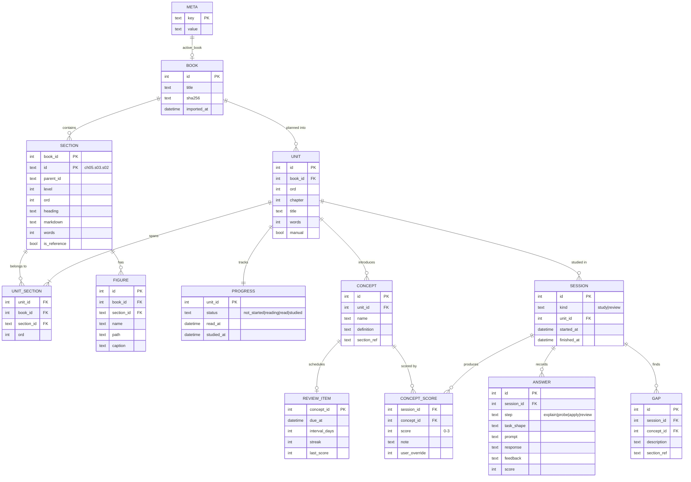

# 02 Data model

SQLite in WAL mode at `/data/ddia.db`. Migrations are embedded in the binary and run on start.

- **DAT-1** `section_fts` is an FTS5 table over `heading` and `markdown` for non-reference sections.
- **DAT-2** A concept's *current score* is its latest `CONCEPT_SCORE`, with `user_override`
  taking precedence over `score` when it is set.
- **DAT-3** Raw answers (`ANSWER.response`) MUST be stored verbatim. They're the evidence used to audit a score.
- **DAT-4** Deleting a book MUST cascade. No other deletes are exposed.
- **DAT-5** Units count as *in read scope* when their `PROGRESS.status` is `read` or `studied`.
- **DAT-6** Each book's data is separate. A section is keyed by `(book_id, id)`, a figure name is unique
  within its book, and `section_fts` carries the book ID. Units, sessions and concepts keep global integer
  IDs, so a unit number names one unit across all books. A `section_ref` on a concept or gap is read
  within that concept's or session's book. Upgrading a database from before multi-book support MUST keep
  all of its data as book 1.
- **DAT-7** The active book is stored in `meta` under `active_book`. While any book exists, exactly one is
  active. Deleting the active book makes the oldest remaining book active.
