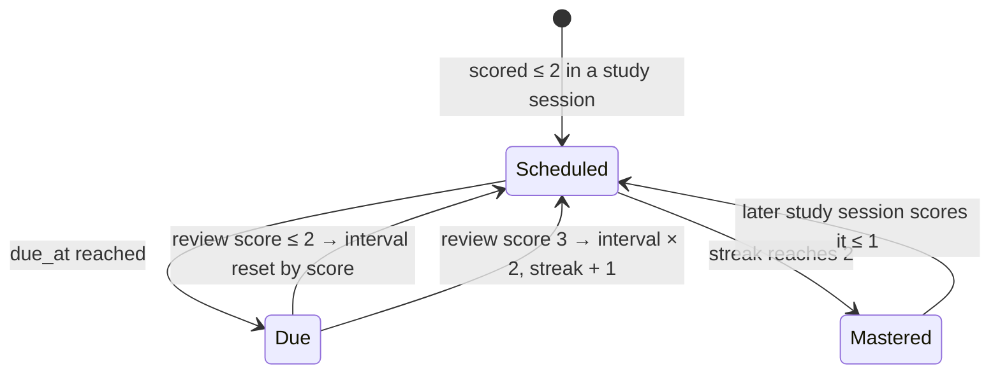

# 05 Review queue

Spaced review works on concepts rather than units: a weak concept comes back on its own,
mixed in with others from across the chapters you've read.

- **REV-1** A concept enters (or re-enters) the queue when it scores 0–2 in a study session, with its interval reset per REV-2.
  A study score of 3 leaves the concept's queue state as it is.
- **REV-2** The first interval depends on the score: 0 → 1 day, 1 → 2 days, 2 → 7 days.
- **REV-3** In a review, a score of 3 doubles the interval (capped at 60 days) and adds one to the
  streak. A score of 0–2 resets the interval per REV-2 and sets the streak to 0.
- **REV-4** A concept with streak 2 counts as mastered and leaves the queue. It comes back if a later session scores it ≤ 1.
- **REV-5** The `ddia-review` prompt fetches due items (`get_due_reviews`) and asks one short
  question per concept. The question MUST differ from the last one recorded for that concept,
  and SHOULD use one of the SES-8 task shapes. Each answer is recorded with `record_review`.
- **REV-6** Review questions follow the read-scope rule (MCP-1) like everything else.
- **REV-7** Overriding a concept's current score in the UI (SES-11) also reschedules it: 0–2 resets per REV-2,
  and 3 marks it mastered.
- **REV-8** The `ddia-review` prompt gives the same English feedback after each answer as a study
  session (SES-14, SES-16), under the same chat-only rule (SES-15).
- **REV-9** The review queue is per book: `get_due_reviews`, the due count and the concepts page cover the
  active book only (MCP-9). Switching books, or `ddia-review` with a `book` arg (MCP-10), reviews another book's queue.
- **REV-10** Review questions follow SES-17: the heading or label before each question shows only the
  count and the shape (e.g. "Question 3 of 10 (`explain_failure`)"), never the concept's name. The
  concept is named in the feedback, after the answer.
- **REV-11** Weakest first. `get_due_reviews` orders due items by their last score, lowest first
  (0 missing, then 1 shaky, then 2 solid, then 3), and within one score by `due_at`, most overdue
  first. So when more items are due than the session's `limit`, the session takes the weakest ones
  and solid items wait. The `ddia-review` prompt asks the questions in the order returned.
