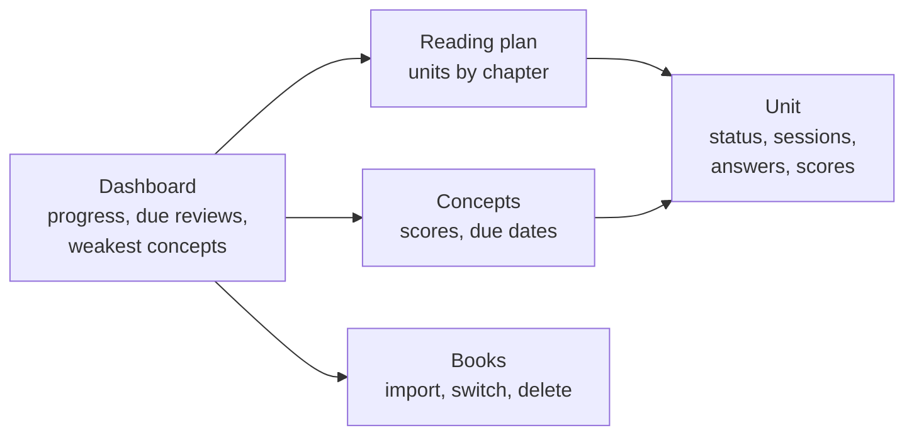

# 06 Web UI

Server-rendered Go templates (embedded `templates/*.html`) with plain HTML forms. There's no SPA build step;
htmx can be added later if a page needs partial updates.
The UI is a tracker: it never shows book text beyond headings.

- **UI-1 Import.** Upload an EPUB, see a parse summary (chapters, sections, figures, word counts,
  proposed units), confirm. Import lives on the Books page (UI-9) and is always available.
- **UI-2 Reading plan.** Units grouped by chapter, showing word count, approximate page count, status
  and the latest average score. Units can be merged, split at a heading or renamed (ING-11, ING-12).
- **UI-3 Mark read / unread.** One button per unit. After it's clicked, the page shows a hint: "Open Claude
  Desktop and run /ddia-study". A read unit can be marked unread again (back to "not started", after a
  confirmation), and the unit page can also set "reading". Unreading takes the unit out of read scope (DAT-5)
  and clears its read time; recorded sessions and scores are kept. "Studied" is never set by hand.
- **UI-4 Unit page.** Section headings (headings only), and every session with its questions, your
  verbatim answers, feedback, scores and gaps. Each gap links to its section ID. Scores can be overridden inline.
- **UI-5 Concepts page.** All concepts in read scope with current score, review due date and streak. Sortable, with the weakest first by default.
- **UI-6 Dashboard.** Units read and studied per chapter, the number of due reviews, and the five weakest concepts.
- **UI-7** The UI MUST NOT render section Markdown. You read in your own reader.
- **UI-8 Unit numbers.** The reading plan, unit page and dashboard show each unit's number (`#12`). The unit
  page says how to study it: pick `ddia-study` in Claude Desktop and enter that number, or leave it empty for
  the next read unit (MCP-6).
- **UI-9 Books page.** Lists every book with its units read and studied, marks the active one, and lets you
  make another book active or delete one (with a confirmation; DAT-4, DAT-7). Shows the import form.
- **UI-10 Active book.** Every page shows the active book's title in the header with a switcher. The dashboard,
  reading plan and concepts page cover the active book only. A unit page works for any unit and says which book
  it belongs to.
