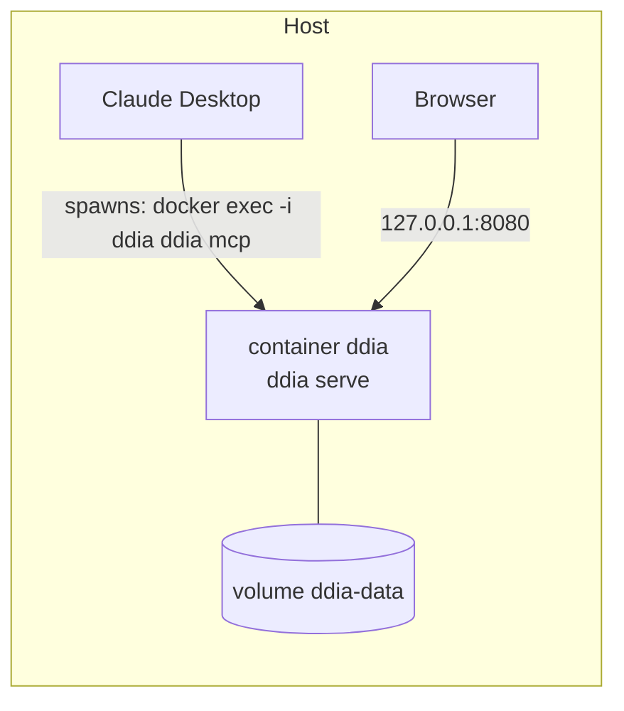

# 07 Deployment



- **DEP-1** The service ships as one Docker image: a static Go binary on a distroless base, with SQLite built
  in through a cgo-free driver (FTS5 included).
- **DEP-2** `docker compose up -d` MUST be enough to start it. The port is bound to `127.0.0.1` only, and data lives in
  the named volume `ddia-data`. A named volume is used rather than a host bind mount like `./data`: on Linux, Docker creates a missing bind-mount
  directory owned by root, and the container's non-root user then can't write to it. To back up, see DEP-8.

```yaml
services:
  ddia:
    build: .
    image: ghcr.io/paulnopaul/ddia-assist:latest
    container_name: ddia
    command: ["serve"]
    ports: ["127.0.0.1:8080:8080"]
    volumes: ["ddia-data:/data"]
    restart: unless-stopped

volumes:
  ddia-data:
    name: ddia-data
```

- **DEP-3** Claude Desktop connects through a stdio bridge into the running container. There's nothing to install on the host:

```json
{
  "mcpServers": {
    "ddia": {
      "command": "docker",
      "args": ["exec", "-i", "ddia", "/ddia", "mcp"]
    }
  }
}
```

- **DEP-4** `/mcp` (streamable HTTP) is also served for clients that can reach localhost
  directly, such as Claude Code. If Claude Desktop gains localhost HTTP support, it can switch to the URL with no other changes.
- **DEP-5** There's no authentication, because of DEP-2's localhost binding. The book text only leaves the
  machine inside your own Claude conversations.
- **DEP-6** CI builds and tests on every PR and publishes the image to GHCR from `main`.
- **DEP-7** A `Makefile` is the one entry point for common tasks: `up`, `down`, `test`, `lint`, `vet`, `build`
  and `backup`. The Dockerfile's build stage MUST run `make lint vet test build`, and CI MUST run the same
  `lint`, `vet` and `test` targets, so a local run, CI and the image build check the same things.
- **DEP-8** `make backup` stops the `ddia` container if it is running, copies `/data` out of it into
  `backups/ddia-data-<UTC time>.tar.gz` on the host, and starts the container again only if it was running.
  Stopping first lets SQLite checkpoint its WAL, so the copy is consistent. The container MUST be started again
  even when the copy fails. `backups/` holds book text and is git-ignored. To restore, stop the container and copy
  the archive's `data/` back with `docker cp`.
